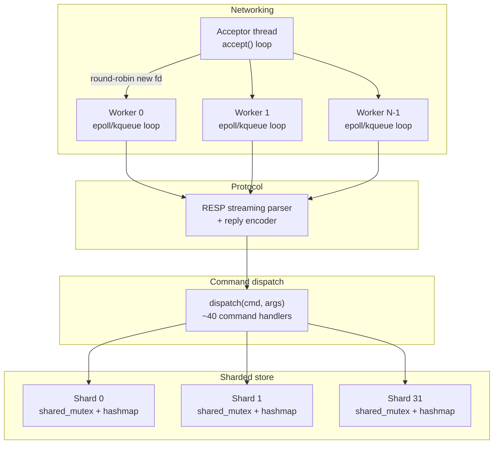
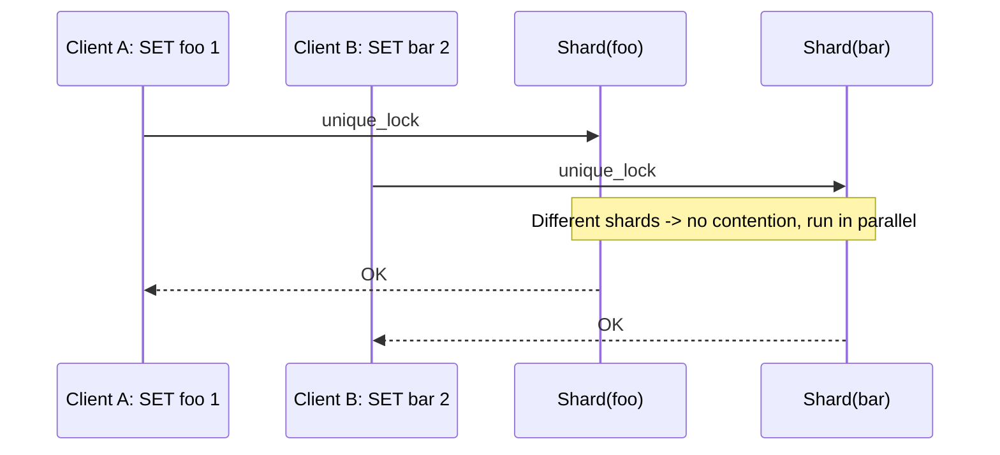
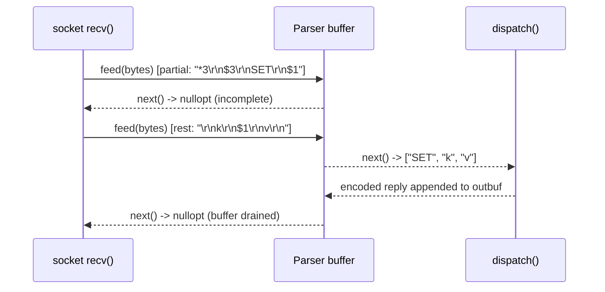
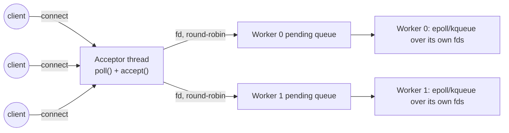
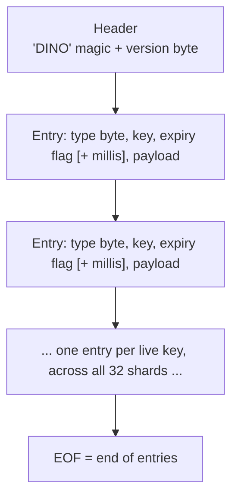
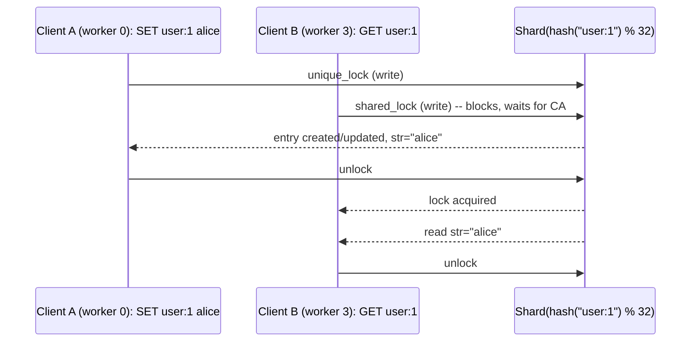

# Building DinoDB: a sharded, multi-threaded key-value store in C++

*~20 minute read · systems, C++, concurrency, networking*

---

## Why build another Redis

Redis's core trick is deceptively simple: run every command on a single
thread. No locks, no races, no torn reads — the entire data structure
engine gets to pretend concurrency doesn't exist, because from its point
of view it doesn't. That buys enormous simplicity, and for years it was
also fast enough, because a single core can push millions of simple
operations per second and the network stack is usually the real
bottleneck anyway.

But "fast enough" has a ceiling, and the ceiling is one core. If your
workload is CPU-bound — big `ZRANGE` scans, large hash operations, many
concurrent clients each doing real work — a single-threaded engine simply
cannot use the seven other cores sitting idle next to it. Redis's own
answer, over the years, has been to lean on clustering (shard across
*processes*, not threads) rather than take on internal concurrency.

DinoDB asks a narrower question: what does an in-memory KV store look
like if you *do* let multiple threads execute commands at once, and pay
for that with real synchronization instead of getting it for free? Not
lock-free, epoch-reclaimed, seqlock-validated concurrency — that's a
different, much harder project — but the simplest thing that can
plausibly work: **partition the keyspace into shards, put a
reader-writer lock on each one, and let unrelated keys never see each
other's locks.**

This post walks through how that's built, from the wire protocol up to
the on-disk snapshot format.

## Design goals

1. **Speak RESP** — `redis-cli` and any standard Redis client library
   should be able to talk to it with zero adaptation.
2. **Real parallelism, not the illusion of it** — two clients touching
   two different keys should never wait on each other, on any code path.
3. **A codebase one person can hold in their head** — every subsystem
   (parser, store, dispatcher, reactor, persistence) is small, has one
   job, and is unit-testable in isolation.
4. **Boring primitives** — reader-writer locks, a level-triggered
   readiness loop, plain TCP sockets. No lock-free tricks and no
   external dependencies beyond the C++ standard library. The one
   platform-specific piece is a ~100-line wrapper that uses `epoll` on
   Linux and `kqueue` on macOS.

## Architecture overview

Four layers, each one only aware of the layer directly below it:



- **Networking** owns file descriptors and nothing else. One acceptor
  thread blocks on `accept()`; every new connection is handed to one of
  N worker threads round-robin. Each worker runs its own event loop
  over the connections it owns — no connection is ever touched by more
  than one thread, so the networking layer itself needs zero locks.
- **Protocol** turns bytes into requests and replies back into bytes.
  It knows nothing about what a `SET` does.
- **Dispatch** knows what every command does, but not how bytes got to
  it or where the store's locks live.
- **The sharded store** is the only place a mutex is ever taken.

Each layer being ignorant of the ones above it is what makes the whole
thing unit-testable without spinning up a socket — the test suite calls
`dispatch()` directly against a `Store` and never touches the network at
all.

## The store: sharding instead of one big lock

The naive version of a thread-safe hash map is `std::mutex` plus
`std::unordered_map`. It works, and it also means every single command —
`GET`, `SET`, `TTL`, doesn't matter — serializes behind the same lock. At
that point the extra worker threads are pure overhead: you've built a
single-threaded database with more context-switching.

DinoDB instead fixes the shard count at 32 and hashes every key into
exactly one of them:

```cpp
class Shard {
public:
    std::shared_mutex mtx;
    std::unordered_map<std::string, Entry> map;
};

Shard& Store::shard_for(const std::string& key) {
    size_t h = hasher_(key);
    return *shards_[h % shards_.size()];
}
```

Every read (`GET`, `HGET`, `TTL`, ...) takes a `shared_lock` on exactly
one shard; every write (`SET`, `DEL`, `LPUSH`, ...) takes a
`unique_lock` on exactly one shard. Two clients hitting different shards
never block each other — including two writers. Two clients hitting the
*same* key still serialize, same as Redis's single global thread would,
but now that's the exception, not the rule:



With 32 shards and a reasonable hash distribution, two random keys land
in the same shard about 1-in-32 of the time — contention drops roughly
linearly with shard count, at the cost of 32 mutexes' worth of memory
and a hash computation per lookup. That's the whole trade: DinoDB is
choosing *coarse, cheap, well-understood* parallelism over *fine-grained,
expensive, hard-to-verify* parallelism.

### What actually lives in a shard

Rather than a tagged union of heap-allocated containers, every key maps
to one fixed-layout `Value` struct big enough to hold any of the five
supported types:

```cpp
struct Value {
    ValueType type;                              // which field is "live"
    std::string str;                              // String
    std::unordered_map<std::string, std::string> hash;  // Hash
    std::deque<std::string> list;                  // List
    std::unordered_set<std::string> set;            // Set
    std::unordered_map<std::string, double> zscores; // ZSet: member -> score
    std::set<std::pair<double, std::string>> zorder; // ZSet: (score, member)
};

struct Entry {
    Value value;
    std::optional<std::chrono::system_clock::time_point> expires_at;
};
```

This is a deliberate simplification versus e.g. Redis's `listpack`/
`intset`/`embstr` family of size-tuned encodings, or an epoch-reclaimed
structure that hands back memory to other threads lazily. Every key
here costs roughly `sizeof(Value)` regardless of whether it holds a
3-byte string or a 10,000-entry hash — noticeably more memory overhead
per key, in exchange for an ownership model simple enough that there is
no reclamation problem to solve at all: a `std::unique_lock` is held,
the struct is mutated in place, the lock is released. No epochs, no
hazard pointers, no deferred frees.

Sorted sets get two structures instead of one specifically so that
`ZRANGE` (score-ordered) doesn't have to sort on every call: `zscores`
answers "what's this member's score" in O(1), and `zorder` — a
`std::set<std::pair<double, std::string>>` — keeps the score-sorted view
maintained incrementally on every insert/update/remove. Ordering by the
`(score, member)` pair, rather than a `multimap` keyed on score alone,
buys two things: Redis's tie-break rule (members with equal scores sort
lexicographically) falls out for free, and removing a member's stale
entry is a single O(log n) `erase` instead of a scan over every member
sharing that score:

```cpp
void zset_put(const std::string& member, double score) {
    auto it = zscores.find(member);
    if (it != zscores.end()) {
        zorder.erase({it->second, member});  // drop the stale (old_score, member)
        it->second = score;
    } else {
        zscores.emplace(member, score);
    }
    zorder.emplace(score, member);
}
```

### Holding the lock for the whole command

Taking "one lock per command" literally matters. An early version of
the `Store` API looked like this:

```cpp
Entry* Store::get_mut(const std::string& key) {
    Shard& s = shard_for(key);
    std::unique_lock lock(s.mtx);
    auto it = s.map.find(key);
    ...
    return &it->second;   // lock is released here...
}
// ...so the caller mutates the entry with no lock held at all.
```

It returned a pointer into the shard *after* the lock had gone out of
scope, so every command handler read and mutated values completely
unsynchronized. Under load that showed up as lost `INCR`s (31,992 out of
32,000 in a 16-client test) and, under ThreadSanitizer, as a crash
inside `std::deque` while two `LPUSH`es raced on the same list.

The fix is to never hand out a pointer that can outlive its lock. The
`Store` now takes the work to the data instead: callers pass a lambda,
and it runs while the shard lock is held:

```cpp
// Shared lock; e is nullptr if the key is missing or expired.
c.store.read(key, [](const Entry* e) { ... });

// Exclusive lock; the whole read-modify-write is atomic.
c.store.write(key, [&](Slot& slot) {
    Entry* e = slot.get();               // nullptr if absent
    ...
    slot.get_or_create(ValueType::String).value.str = std::to_string(cur);
});
```

`Slot` is a small handle to one key's position in its shard. It also
takes care of a Redis rule that is easy to forget: when its destructor
runs (still under the lock), a list, set, hash or sorted set that a
command just emptied is deleted, so `LPOP`ing the last element really
does make the key disappear.

### Expiry: lazy, plus a background sweep

Every access checks `expires_at` against `now()` under the shard lock it
already holds and treats a stale entry as missing (write paths erase it
on the spot). On its own that means a key nobody ever reads again would
outlive its TTL in memory forever, so a housekeeping thread also sweeps
one shard every 100ms, erasing whatever has expired. A full pass over all
32 shards takes about three seconds, and the sweep never holds more than
one shard's lock at a time.

The sweep walks the whole shard, so it has to know when to stay away. Each
shard keeps a `may_have_ttl` flag, set whenever a write leaves an entry
with a TTL and cleared when a sweep finds none left; shards without TTLs
are skipped. Before that flag existed, a server holding a million keys
and no TTLs at all spent about 5% of a core walking hash-table nodes for
nothing, even when idle. Redis avoids the same trap by keeping keys with
a TTL in a separate `expires` table and sampling only from that.

## The wire: a streaming RESP parser

Real Redis clients send **RESP multibulk arrays** — `*3\r\n$3\r\nSET\r\n...`
— but the parser also accepts plain space-separated inline commands
(`PING\r\n`), which makes manual testing with `nc` painless. TCP gives
you a byte stream, not message boundaries, so the parser has to cope
with a request arriving in pieces across multiple `recv()` calls, or
multiple requests arriving in a single `recv()`:

```cpp
class Parser {
public:
    void feed(const char* data, size_t len);       // append raw bytes
    std::optional<Request> next();                  // pop one complete request, if any
private:
    std::string buf_;
    size_t pos_ = 0;   // parse cursor; buf_ is compacted periodically, not on every call
};
```

`next()` is the whole contract: call it in a loop after every `feed()`.
If a complete request is sitting in the buffer it comes back immediately;
if the buffer ends mid-length-prefix or mid-bulk-string, it returns
`nullopt` and leaves `pos_` untouched, so the next `feed()` picks up
exactly where parsing left off.

Because the parser buffers whatever the client claims is coming, it also
enforces Redis's default limits (at most 1M arguments per request, 512MB
per bulk string, 64KB per inline command) and never sizes an allocation
from a client-supplied count. Anything malformed or over the limits puts
the parser into a sticky error state; the server replies with
`-ERR Protocol error: ...` and closes the connection. The buffer is only compacted (bytes
before `pos_` erased) once it's grown past a threshold, so a stream of
small pipelined requests doesn't pay a `memmove` per request.



## The reactor: one acceptor, N pollers, zero shared state per connection

Each worker waits on its own `epoll` (Linux) or `kqueue` (macOS)
instance, behind a small `Poller` wrapper in `src/poller.hpp`. The first
version used plain `poll()`, which is portable POSIX but makes the
worker rebuild and pass its whole fd list on every iteration, and the
kernel rescan it. Profiling showed that cost was not academic: with four
workers and no pipelining, switching to `epoll`/`kqueue` roughly halved
server CPU per request (23 → 12 µs on an M4). Both backends are used
level-triggered, so the loop keeps `poll()`'s simple semantics: anything
left unread or unsent is reported again next time.



Ownership is the key invariant: once the acceptor hands a file
descriptor to worker *i*'s pending queue, only worker *i* ever calls
`recv()`, `send()`, or `close()` on it. There is exactly one `std::mutex`
in the entire networking layer — guarding each worker's pending-fd
queue — and it's held only for the microseconds it takes to push or
drain a `std::deque<int>`. After queueing an fd, the acceptor writes one
byte to that worker's wake-up pipe, which the worker's poller also
watches, so the worker picks the connection up immediately. No connection state is ever shared between
threads, so the per-connection buffers (`resp::Parser`, the pending
output bytes) don't need any synchronization at all.

Each worker's loop, per iteration:

1. Wait on the poller. It returns only the fds that are ready: client
   sockets, plus the wake-up pipe. The 200ms timeout only bounds how
   quickly shutdown is noticed. An earlier version had no wake-up pipe,
   so a new connection sat unnoticed until the timeout expired and every
   client's first reply took ~200ms. With the pipe it takes ~0.1ms.
2. If the wake-up pipe fired, drain the pending queue and register the
   new fds with the poller.
3. For each readable client: `recv()` what's there, feed it to that
   connection's parser, `dispatch()` every complete request that falls
   out, and append each encoded reply to the connection's output buffer.
4. Only after every ready connection has been read, flush each output
   buffer with `send()`. A partial send turns on write interest for that
   fd, and the rest goes out when the poller reports it writable.

Step 4 is the same order Redis uses (it writes replies in
`beforeSleep`, right before going back to `epoll_wait`), and on Linux it
matters more than you'd guess. With replies sent as soon as each
connection was processed, a single worker spent about 50% more kernel
time per request than Redis with the very same syscalls. Over loopback,
a `send()` delivers the data and wakes the client in the sender's
context, so interleaving sends with reads meant clients woke up and
competed for the CPU while the worker still had other connections to
read. Reading everything first and then sending cut kernel time per
request from about 0.9 µs to 0.6 µs and raised single-worker pipelined
`GET` throughput by about 25%.

## Command dispatch

`dispatch()` is a case-insensitive hash-table lookup over ~60 commands
covering five data types plus key/server management. No command object
graph, no visitor pattern — just a function that takes a `Store&` and a
parsed request and returns an already-RESP-encoded reply string:

| Category | Commands |
|---|---|
| Generic | `DEL` `EXISTS` `TYPE` `EXPIRE` `PEXPIRE` `TTL` `PTTL` `PERSIST` `KEYS` `FLUSHALL` `DBSIZE` |
| Strings | `SET` (`EX`/`PX`/`NX`/`XX`) `GET` `GETSET` `APPEND` `STRLEN` `MSET` `MGET` `INCR` `DECR` `INCRBY` `DECRBY` |
| Hashes | `HSET` `HGET` `HDEL` `HEXISTS` `HGETALL` `HKEYS` `HVALS` `HLEN` `HINCRBY` |
| Lists | `LPUSH` `RPUSH` `LPOP` `RPOP` `LLEN` `LRANGE` `LINDEX` |
| Sets | `SADD` `SREM` `SISMEMBER` `SMEMBERS` `SCARD` |
| Sorted sets | `ZADD` `ZSCORE` `ZREM` `ZCARD` `ZINCRBY` `ZRANGE` |
| Server | `PING` `ECHO` `INFO` `SAVE`/`BGSAVE` `SELECT` `CONFIG` (stub) |

Each table entry carries a Redis-style arity (`3` means exactly three
arguments including the command name, `-3` means at least three), so
argument-count errors are produced in one place with Redis's exact
wording. Every handler then follows the same shape: parse and validate
arguments up front (so a bad `ZADD` score can't leave a half-applied
update), then do all its work on a key inside a single `Store::read` or
`Store::write` call and encode the reply. Multi-key commands (`MSET`,
`MGET`, `DEL`) take one shard lock per key in turn, so each key's update
is atomic but, unlike in Redis, the command as a whole is not.

### Asymptotic cost per operation

| Command | Cost | Why |
|---|---|---|
| `GET` / `SET` / `HGET` / `SADD` | O(1) amortized | hash lookup in one shard |
| `LPUSH` / `RPOP` | O(1) | `std::deque` push/pop at either end |
| `LRANGE start stop` | O(k) | k = size of the returned slice |
| `ZADD` / `ZINCRBY` | O(log n) | `std::set` erase + insert, n = zset size |
| `ZRANGE start stop` | O(start + k) | walks `zorder` from the front to `start`, then k results |
| `KEYS pattern` | O(total keys) | full scan across all 32 shards |

`ZRANGE`'s linear walk (rather than O(log n + k) via an order-statistics
tree) and `KEYS`'s full scan are the two honest weak points in the
current design — both are correct and simple, neither is what a
production KV store would ship.

## Persistence: a snapshot format, not a log

DinoDB does not implement an append-only file. It has one persistence
primitive — a full point-in-time snapshot — triggered by `SAVE`, a
periodic autosave timer, and a save-on-clean-shutdown hook for
`SIGINT`/`SIGTERM`. The format is a small custom length-prefixed binary
layout, unrelated to Redis's RDB format:



Each entry's payload shape depends on its type byte — a length-prefixed
string for `String`, a count followed by key/value pairs for `Hash`,
and so on for `List`/`Set`/`ZSet`. Writing is a single pass over
`Store::for_each`, which holds one shard's shared lock at a time while
that shard's live (non-expired) entries are serialized. Reads proceed
during a `SAVE`, and a write only waits if it targets the shard currently
being written out. A mutex in `Server` also keeps a client `SAVE` and
the autosave timer from writing the snapshot at the same time.

Durability is via the standard write-temp-file, `fsync`, `rename`
pattern: `SAVE` always writes to `dinodb.rdb.tmp` first and atomically
renames it over `dinodb.rdb` only after every byte is flushed — a
crash mid-write leaves the previous snapshot untouched rather than a
half-written file.

Loading is all-or-nothing. The whole file is parsed into a staging
buffer first, and the store is only populated if every record checks
out (with length fields sanity-capped so a corrupt one can't trigger a
multi-gigabyte allocation). If the file is damaged, the server refuses
to start, as Redis does. The alternative, starting empty, would let the
next autosave quietly overwrite whatever was still recoverable.

## Concurrency safety invariants

The whole locking story rests on a short list of invariants, each one
enforced structurally rather than by convention:

- **A key belongs to exactly one shard, always**, because
  `shard_for(key)` is a pure function of the key's hash — there is no
  code path where a key's shard changes over its lifetime.
- **No pointer into a shard outlives its lock.** Handlers only see
  entries inside `Store::read`/`Store::write` callbacks, which run with
  the shard lock held; command handlers never reach into a `Shard`
  directly. The test suite runs under ThreadSanitizer in CI to keep it
  that way.
- **A connection's buffers are touched by exactly one thread.** Once
  the acceptor enqueues an fd to worker *i*, no other worker ever sees
  that fd again, so `resp::Parser` and the per-connection output buffer
  need no synchronization of their own.
- **`for_each` (used by `KEYS`, `SAVE`, `DBSIZE`) takes a shared lock
  per shard, one shard at a time** — never all 32 at once — so a full
  scan can't deadlock against, or starve, a concurrent single-key write
  on some other shard.

## A concrete trace

Two clients, one `SET`, one `GET`, same key, arriving on different
worker threads at roughly the same time:



Nothing here is DinoDB-specific — it's exactly what a `std::shared_mutex`
guarantees. The interesting part is what *doesn't* happen: a third
client doing `SET other:key 1` on a different shard runs concurrently
with both of these, untouched, on a third worker thread, the whole
time.

## Does the trade actually pay off?

The point of all that locking is multi-core throughput, so I measured it
(`scripts/bench.py`, Apple M4, against Redis 8.10; full tables in the
README). Two things stood out.

First, an honest benchmark on one laptop is harder than it looks. For
small `GET`/`SET` requests, every server, Redis and DinoDB alike, landed
at about 145k req/s without pipelining and about 2.2–2.4M with it. That is
the ceiling of `redis-benchmark` and loopback TCP, not of either server.
`redis-benchmark`'s own throughput numbers were also quantized for short
runs (results snapped to exactly 1,000,000 or 2,000,000), so the script
computes throughput from wall-clock time and records server CPU time per
request, which doesn't depend on who the bottleneck is.

Second, once the server *is* the bottleneck, the design delivers. With
`LRANGE` returning 100–300 elements from one shared list, every request
takes a `shared_lock` on the same shard and they all proceed in parallel:

| | Redis | Redis, 4 I/O threads | DinoDB, 1 worker | DinoDB, 4 workers |
|---|---:|---:|---:|---:|
| `LRANGE 0 99` | 296k req/s | 333k | 250k | **399k** |
| `LRANGE 0 299` | 121k req/s | 140k | 105k | **174k** |

That's about 1.4x Redis, with lower p99 latency. Redis's I/O threads
parallelize socket reads and writes, but command execution, including
encoding those 300-element replies, still happens on one thread.

The cost is just as clear. Per core, DinoDB is less efficient: a single
worker needs 25–30% more CPU per request than Redis and trails it on
every workload. Under light load, more workers means more CPU burned per
request, because each wake-up handles fewer requests. Sharded locks buy
parallelism; they don't buy efficiency.

## When this design is (and isn't) the right call

DinoDB's sharded-mutex model is a genuine trade, not a strictly better
version of anything:

| Use it when | Reach for something else when |
|---|---|
| Workload is CPU-bound across many independent keys | Workload is dominated by a handful of hot keys — sharding doesn't help those |
| You want to reason about correctness with plain `std::shared_mutex` semantics | You need to squeeze out the last 20% of throughput and can justify a lock-free design's audit cost |
| Memory headroom for a fixed-layout `Value` per key is fine | Key count is huge and per-key overhead has to be minimized |
| A snapshot-based durability model is acceptable | You need Redis's AOF-level durability guarantees |

## What's not here yet

Pub/Sub, `MULTI`/`EXEC` transactions, Lua scripting, `SCAN` cursors,
streams, bitmaps, HyperLogLog, geospatial commands, and any form of
replication or clustering are all absent. Each is a reasonably
self-contained addition given the existing layering — `SCAN`, for
instance, is mostly a cursor wrapped around the same `for_each` that
already powers `KEYS`.

Source: [github.com/udaysehgal/dinodb](https://github.com/udaysehgal/dinodb)
